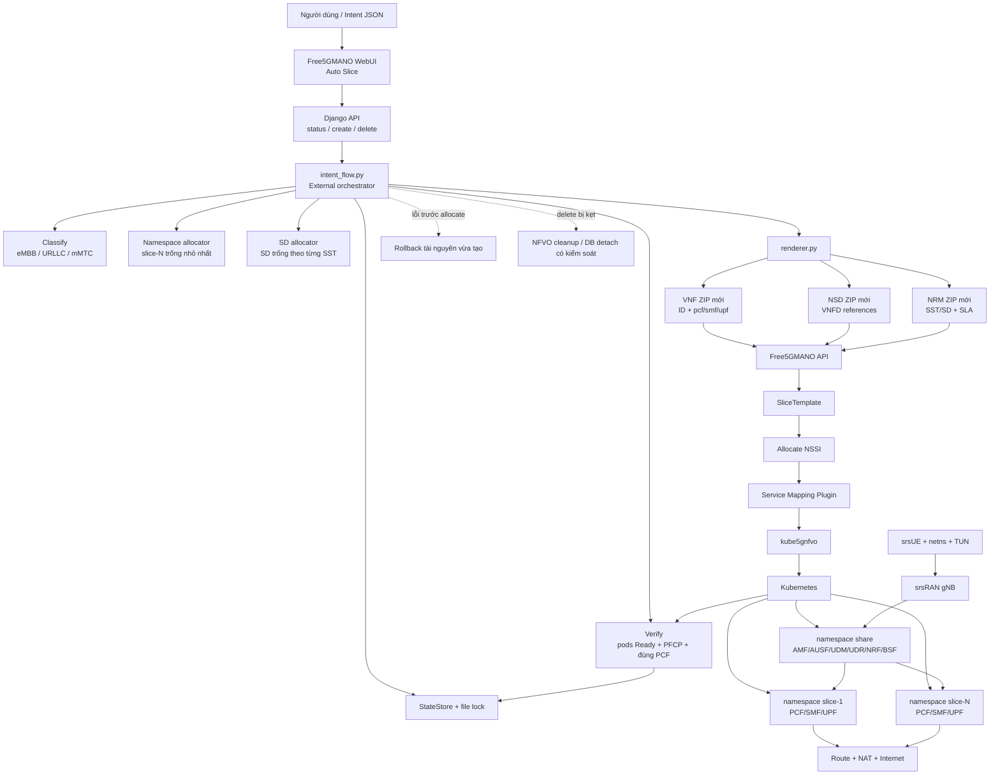

# Sơ đồ chức năng và kịch bản kiểm thử toàn hệ thống

## 1. Tại sao cần project này?

Free5GMANO cung cấp các API/template và chức năng allocate NSSI, nhưng flow thủ
công phải tự chọn namespace, sửa descriptor ID, SST/SD, subnet, upload ba loại
template, bind template rồi mới allocate. Các lỗi đã gặp trong lab gồm:

- descriptor ID trùng hoặc tên pod không thể hiện PCF/SMF/UPF;
- SMF dùng một SST/SD nhưng NRM vẫn giữ SST/SD cũ;
- namespace Kubernetes còn sót làm slot mới nhảy sai;
- SD bị gắn với số namespace thay vì được cấp độc lập trong từng SST;
- thao tác delete WebUI có thể để lại NSSI/NFVO/namespace;
- nhiều yêu cầu đồng thời có thể chọn cùng slot nếu không khóa state;
- UE đăng ký thành công nhưng lỗi GW vì netns/TUN, route hoặc NAT chưa chuẩn bị.

Auto Slice gom các bước trên thành một flow có state lock, render động, kiểm tra,
rollback và bằng chứng test lặp lại được.

## 2. Sơ đồ chức năng



## 3. Phạm vi kiểm thử

### Kiểm thử an toàn, không thay đổi hệ thống

```bash
cd /home/ubuntu/mano/intent_flow_v2
python3 intent_flow.py doctor
python3 intent_flow.py web-status
PYTHONDONTWRITEBYTECODE=1 python3 -m unittest discover -s tests -v
```

Tiêu chí PASS:

- `doctor.status = OK`;
- eMBB, URLLC, mMTC đều render được;
- 7/7 unit test đạt;
- `web-status` không báo tracked NSSI bị mất ngoài dự kiến.

### Kiểm thử có thay đổi hệ thống

Chỉ chạy khi đã chụp lại output `web-status` và biết slice nào đang được dùng.
Không chạy test rollback/force delete trên slice đang phục vụ UE.

## 4. Kịch bản demo end-to-end

### TC01 – Tạo eMBB tự động

Mục tiêu: chứng minh một nút thay thế toàn bộ flow thủ công.

1. Mở `/Auto_Slice/`, ghi lại `Next namespace` và `Next SD`.
2. Bấm `Create & Allocate eMBB`.
3. Chờ trạng thái `READY`.
4. Kiểm tra:

```bash
kubectl get pods -n <namespace>
python3 /home/ubuntu/mano/intent_flow_v2/intent_flow.py web-status
```

PASS khi:

- SST là `1`;
- SD đúng giá trị preview;
- namespace đúng slot preview;
- có đúng PCF, SMF, UPF và cả ba pod `1/1 Running`;
- tên descriptor/pod có hậu tố `pcf`, `smf`, `upf`;
- SMF log có `PFCP associated`.

### TC02 – Chứng minh SD độc lập theo SST

1. Khi eMBB SST 1 đang dùng SD `000001`, tạo URLLC SST 2.
2. Tạo mMTC SST 3.
3. Xem bảng Auto Slice.

PASS khi ba slice có thể đồng thời dùng:

```text
eMBB  : SST 1 / SD 000001
URLLC : SST 2 / SD 000001
mMTC  : SST 3 / SD 000001
```

Không được coi SD trùng giữa các SST là xung đột.

### TC03 – Cấp SD tiếp theo trong cùng SST

1. Giữ eMBB SST 1 / SD `000001`.
2. Tạo thêm một eMBB.

PASS khi eMBB mới nhận SD `000002`, không phụ thuộc số namespace.

### TC04 – Đồng bộ VNF/NSD/NRM

1. Lấy `render_manifest` của slice trong state.
2. Giải nén ba ZIP đã render.
3. Đối chiếu:

- SMF config;
- NSD `vnfd_id`;
- NRM `SnssaiList`;
- namespace/FQDN;
- IPv4 subnet/gateway.

PASS khi VNF, NSD và NRM có cùng SST/SD/namespace, NSD tham chiếu đúng toàn bộ
VNFD ID mới và không còn FQDN của slice cũ.

### TC05 – Attach UE và kiểm tra data plane

Chuẩn bị trước khi chạy srsUE:

```bash
sudo ip netns add ue1 2>/dev/null || true
sudo ip netns exec ue1 ip link set lo up
sudo mkdir -p /etc/netns/ue1
```

Sau khi srsUE báo `PDU Session Establishment successful`:

```bash
sudo ip netns exec ue1 ip route replace default dev tun_srsue1

UPF_POD=$(kubectl get pod -n slice-1 -o name | grep upf | head -1)
UPF_IP=$(kubectl get -n slice-1 "$UPF_POD" -o jsonpath='{.status.podIP}')
sudo ip route replace 10.45.1.0/24 via "$UPF_IP" dev cni0

sudo iptables -t nat -C POSTROUTING \
  -s 10.45.1.0/24 -j MASQUERADE 2>/dev/null ||
sudo iptables -t nat -A POSTROUTING \
  -s 10.45.1.0/24 -j MASQUERADE

sudo ip netns exec ue1 ping -c 3 10.45.1.1
sudo ip netns exec ue1 ping -c 3 8.8.8.8
sudo ip netns exec ue1 ping -c 3 google.com
```

PASS khi:

- UE báo `RRC Connected`;
- PDU Session thành công và có IP `10.45.1.x`;
- interface `tun_srsue1` tồn tại;
- ping gateway, Internet IP và DNS đều `0% packet loss`;
- SMF/UPF giữ một session, không Added/Removed lặp liên tục.

### TC06 – Tái sử dụng slot và SD sau delete

1. Ghi lại namespace, SST/SD và NSSI cần xóa.
2. Delete từ Auto Slice.
3. Refresh đến khi NSSI biến mất.
4. Tạo lại cùng loại slice.

PASS khi:

- không còn NSSI/NFVO instance cũ;
- slot namespace trống nhỏ nhất được dùng lại;
- SD trống nhỏ nhất trong đúng SST được dùng lại;
- không ảnh hưởng slice khác.

### TC07 – Hai yêu cầu Create đồng thời

Chỉ chạy trong môi trường test.

1. Gửi hai yêu cầu Create gần như đồng thời.
2. Kiểm tra state và namespace.

PASS khi hai yêu cầu nhận namespace khác nhau, không trùng intent ID, Generic
Template hoặc SD trong cùng SST. Đây là bằng chứng `StateStore` lock hoạt động.

### TC08 – Rollback khi upload lỗi

Chỉ chạy trên bản sao cấu hình test.

1. Đặt sai một source template ID hoặc endpoint tạm thời.
2. Chạy Create.
3. Khôi phục cấu hình ngay sau test.

PASS khi:

- create trả lỗi rõ ràng;
- namespace/template do lần chạy lỗi tạo ra được rollback;
- slice đang chạy trước test không bị thay đổi;
- state ghi `ROLLED_BACK`.

### TC09 – Repair delete

Chỉ dùng với NSSI test bị kẹt.

1. Chạy delete dry-run và lưu output.
2. Thử delete thường.
3. Chỉ khi NFVO còn sót mới dùng `--force-fallback`.
4. Chỉ khi DB vẫn giữ đúng UUID mới dùng `--force-db-detach`.

PASS khi chỉ đúng target bị xóa và các slice còn lại vẫn `READY`.

## 5. Bằng chứng cần lưu cho mỗi lần test

- ảnh trang Auto Slice trước/sau thao tác;
- output `intent_flow.py web-status`;
- `kubectl get pods -A -o wide`;
- ID VNF/NSD/NRM, SliceTemplate, NSSI và NFVO instance;
- `render-manifest.json`;
- SMF log có `PFCP associated`;
- kết quả ping gateway/Internet/DNS;
- timestamp bắt đầu, kết thúc và kết luận PASS/FAIL.

## 6. Thứ tự test khuyến nghị

```text
doctor + unit test
  → TC01 create eMBB
  → TC04 descriptor consistency
  → TC05 UE + Internet
  → TC02 nhiều SST
  → TC03 SD trong cùng SST
  → TC06 delete/reuse
  → TC07 concurrency (môi trường test)
  → TC08 rollback (môi trường test)
  → TC09 repair delete (chỉ khi có lỗi thật)
```
